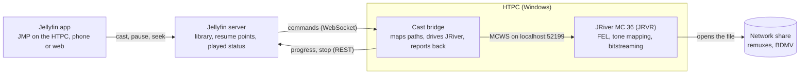
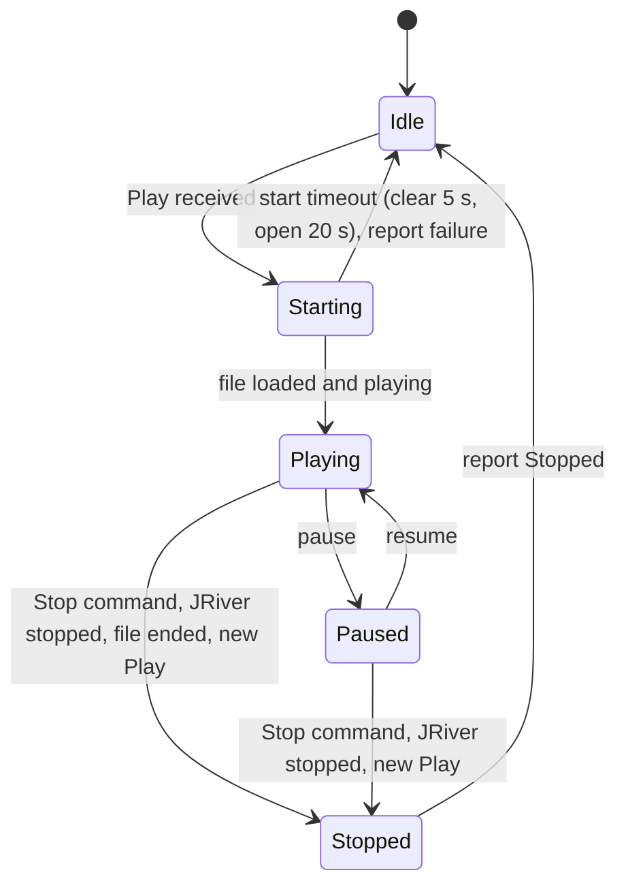

# JRiver Cast Bridge for Jellyfin — design

This document describes how the bridge behaves: what it does, how it talks to Jellyfin and to JRiver Media Center, and how it handles each situation. The code refers to its sections by name (e.g. SPEC.md "JRiver hung"). For installing and using the bridge, see README.md.

## Goal

A small background program for a Windows HTPC that makes JRiver Media Center 36 a cast target in Jellyfin. You browse and press play in a Jellyfin app, mainly Jellyfin Media Player on the HTPC itself, with its 10-foot interface. JRiver plays the original file from the network share with JRVR (Dolby Vision including FEL, tone mapping) and bitstreamed audio. Position and watched status flow back to Jellyfin, so every other client stays in sync.

Why JRiver: MC 36.0.9 added processing of the Dolby Vision Profile 7 enhancement layer in JRVR ([announcement](https://yabb.jriver.com/interact/index.php?topic=143755.0)), combined with JRVR's HDR tone mapping.

## Scope

**Does**

- Appears as a cast target (default name "JRiver (HTPC)") in Jellyfin's cast menus.
- Plays a cast movie or episode in JRiver, full screen, from the share path, starting at Jellyfin's resume position.
- Pause, resume, seek and stop from the Jellyfin remote; audio and subtitle track selection.
- Reports start, progress and stop, so resume points, played status and Next Up update.
- Notices playback stopped or ended inside JRiver and reports it.
- Tray program with login, settings and About windows; installer; starts Jellyfin Media Player at logon; restarts a hung MC.

**Doesn't**

- Any transcoding, stream URLs or server-side conversion.
- Change JRiver audio or video settings (bitstreaming, DSP, JRVR profiles). Those stay the user's.
- Music, SyncPlay, multiple zones, queues (only the item picked plays).
- A browse UI: browsing happens in the Jellyfin app that casts.

## Architecture



Jellyfin stays the library and the remote; JRiver opens the original file straight from the share; the bridge carries commands one way and progress the other.

- **Jellyfin client:** login, cast-target registration, the WebSocket for commands (`socket` module, from JellyPilot), playback reports.
- **Player:** `play(path, start_ms)`, `pause()`, `resume()`, `seek(ms)`, `stop()`, `status()`, implemented over MCWS (`jriver-mcws`).
- **Path mapper:** server path to share path (see Path mapping).
- **Session controller:** the state machine in Playback flow, the watchdog and the playback record.

## Jellyfin side

The server's own OpenAPI (`/api-docs/swagger`) is the reference; the names below say what to look for.

**Register as a cast target**

- Log in with user and password for an access token, with a stable `DeviceId` and the configured device name.
- Post session capabilities (`/Sessions/Capabilities/Full`): `PlayableMediaTypes: [Video]`, `SupportsMediaControl: true`, and the supported commands: `Play`, `PlayState`, plus `PlayMediaSource`, `SetAudioStreamIndex` and `SetSubtitleStreamIndex` when Jellyfin picks the tracks (see "Select tracks").
- Keep the WebSocket (`/socket`) open with keep-alives; reconnect with backoff.

**Handle incoming messages**

| Message | Fields used | Action |
| --- | --- | --- |
| `Play` (PlayNow) | `ItemIds`, `StartIndex`, `StartPositionTicks`, `MediaSourceId`, `AudioStreamIndex`, `SubtitleStreamIndex` | Look up the item's path, start JRiver |
| `Playstate` | `Command`: Pause, Unpause, PlayPause, Seek (`SeekPositionTicks`), Stop | Forward to JRiver |
| `GeneralCommand` | `SetAudioStreamIndex`, `SetSubtitleStreamIndex` (`Arguments.Index`) | Switch tracks; anything else (volume, messages) is logged and ignored |

**Report playback** (always `PlayMethod: DirectPlay`)

- Start: `POST /Sessions/Playing` once JRiver is actually playing.
- Progress: `POST /Sessions/Playing/Progress` every 10 s and on pause, resume, seek and track changes, with `PositionTicks`, `IsPaused`, `AudioStreamIndex` and `SubtitleStreamIndex`.
- Stop: `POST /Sessions/Playing/Stopped` with the last position. The server's own resume settings decide played versus resume; items are never marked played directly.
- The same `ItemId`, `MediaSourceId` and `PlaySessionId` (a generated GUID) go in all three.
- Ticks are 100 ns: ticks = ms × 10,000.

**Find the file**

- `GET /Items/{id}?userId=…` with the `Path` and `MediaSources` fields. When an item has several versions, use the media source matching `MediaSourceId`.
- Never request a stream or `PlaybackInfo` that could plan a transcode.

## JRiver side (MCWS)

JRiver exposes MCWS at `http://localhost:52199/MCWS/v1/` once Media Network is enabled in MC (Options → Media Network). MC serves its own MCWS documentation; it is the reference for every call.

| Need | Call | Notes |
| --- | --- | --- |
| Health check | `Alive` | Poll until MC is up |
| Start a file | `Playback/PlayByFilename?Filenames=<path>` | Appends to Playing Now and plays the new file, so always clear first (next row). Use share paths |
| Clear Playing Now | `Playback/ClearPlaylist` | Stops and clears Playing Now. Asynchronous: wait until `PlayingNowTracks` is 0 and `State` is 0 before `PlayByFilename` |
| Seek | `Playback/Position?Position=<ms>` | A seek while the file is still opening (`State` 3) is acknowledged and then lost; seek once `State` is 2. Afterwards MC echoes the target, frozen, for about 1 s before the position advances |
| Pause / resume | `Playback/Pause?State=<n>` | `State`: 1 pause, 0 unpause, -1 toggle |
| Stop | `Playback/Stop` |  |
| Status | `Playback/Info?Zone=<id>` | `State` (0 stopped, 1 paused, 2 playing, 3 opening), `FileKey`, `PositionMS`, `DurationMS`, `Filename` |
| Full screen check | `UserInterface/Info` | Read-only. MC enters Display view (`Mode` 2) by itself when a video starts, so no full-screen command is sent; a warning is logged if `Mode` isn't 2 |
| Minimize after playback | `Control/MCC?Command=10014&Parameter=1` (`MCC_MINIMIZE_WINDOW`) | Once a playback the bridge started has ended, minimize MC so the Jellyfin app on the HTPC gets focus back (a setting, default on). JRiver documents parameter 1 as *toggling* minimize and restore, so it is sent only when MC was in Display view (`Mode` 2) at the last check before the stop: then it can't already be minimized. The bridge waits up to 5 s for MC to leave Display view, then sends it once. A film the user has Alt+Tabbed away from stays in the background |
| Select tracks | `Control/MCC?Command=10053&Parameter=<n>` (`MCC_SET_AUDIO_STREAM`) and `Control/MCC?Command=10052&Parameter=<n>` (`MCC_SET_SUBTITLES`) | Setting `[bridge] tracks_from_jellyfin` (default on). **On:** play the tracks picked in Jellyfin: at a cast's start whenever Jellyfin gives them, the file's default too (MC remembers the tracks last used in each file, so its own choice may differ), and when a track is picked in the remote while playing. The bridge registers `PlayMediaSource`, `SetAudioStreamIndex` and `SetSubtitleStreamIndex`: jellyfin-web shows an item's version, audio and subtitle pickers while casting only to a target with `PlayMediaSource` (and reads that list only when the target is selected). **Off:** JRiver picks the tracks, no track command is sent, and none of those three commands is registered, so Jellyfin offers no track choice. `<n>` is the track's position among the file's audio (or subtitle) tracks, mapped from Jellyfin's stream index: audio counts from 0, subtitles from 1, and subtitles 0 is off. MC's order for external subtitle files and for disc folders isn't known, so beside an external subtitle file only "subtitles off" is sent (also at a cast's start when Jellyfin asks for none, as MC may show the external file by itself), and a disc folder gets no track commands at all, not even "off": a wrong track is worse than none. MCWS can't read the current track, so reports carry the tracks asked for |
| Auth | `Authenticate` | Only if Media Network authentication is on |
| Restart a hung MC | Not MCWS: Windows `tasklist` (filter: MC's image name, status "Not responding") and `taskkill /f /pid` | Only MC's own process, named by `mcws.exe_path`, and only under the rule in "JRiver hung" |

- Always target one zone by ID (config, default 0 = "Player"); never `Zone=-1`, which means MC's current zone and can be a DLNA renderer.
- Poll `Playback/Info` once a second while playing; MCWS has no push notifications.
- **Hard rules towards MC:** never send volume or mute commands; never call anything that changes MC settings, DSP, audio output or JRVR profiles; never ask MC for a stream or conversion (transcoding). Within those rules any MCWS call or MCC command may be used. Each one is listed in the table above, with what it's for, and is sent through its own named function with a fixed command number: there is no way to send an arbitrary command.

## Path mapping

Jellyfin reports server-side paths; JRiver needs paths the HTPC can open. They are mapped with an ordered prefix list in the config; the first match wins.

```toml
[[path_map]]
from = '/media/movies'
to   = '\\nas\movies'

[[path_map]]
from = '/media/tv'
to   = '\\nas\tv'
```

- Map to UNC paths only, never drive letters: MC imports every file it plays, and the same file under two path forms becomes two library entries.
- Slashes are normalised, the prefix compared case-insensitively on the Windows side, and the result percent-encoded for the MCWS query string.
- Before playing, the mapped path must exist (within 10 s, as a sleeping share can be slow). If not, both paths are logged and a failed stop is reported; never fail silently.
- Shapes: a single file (MKV, M2TS, MP4) and a Blu-ray folder. For a Blu-ray folder (`VideoType` `BluRay`), Jellyfin's `Path` is the release folder; `\BDMV\index.bdmv` is appended after mapping. ISO images and DVDs aren't played.

## Playback flow

The session controller owns one playback at a time and reports every transition to Jellyfin.



1. **Play received:** look up the item and media source, map the path, check it exists.
2. **Start:** `ClearPlaylist` and wait until Playing Now is empty, call `PlayByFilename`, then poll `Playback/Info` until `State` is playing and `DurationMS` > 0 for the new file. Timeouts: 5 s for Playing Now to empty, then 20 s from `PlayByFilename` until the file is playing, so a failed start gives up after at most about 25 s. On a timeout, stop MC, report the failure and return to idle. Jellyfin's only failure report is a stop with `Failed: true` (it leaves the user's resume point and played status alone); the reason goes to the bridge's log.
3. **Resume point:** as soon as the file is playing (`State` 2, a real `FileKey`, the right filename), seek to `StartPositionTicks`, always, even when it is 0. Without that seek, MC jumps to its own bookmark for the file about 1 s after it starts. The landing counts as confirmed when two readings are within ±2 s and the position is advancing (not the frozen echo); if MC drifts off the target, seek once more. This check has its own 5 s limit; if it runs out, playback continues with a warning that the start position isn't confirmed.
4. **Tracks:** select the audio and subtitle tracks (see "Select tracks").
5. **Report start**, and check through `UserInterface/Info` that MC is in Display view (it switches by itself).
6. **Playing or paused:** poll at 1 Hz; report progress every 10 s and on every state change; forward remote commands.
7. **Stop:** on a Stop command, JRiver reaching stopped, or a different file starting, report Stopped with the last known position and return to idle.

**Edge cases**

- **Played to the end:** JRiver stops about 1 s before `DurationMS`, then reports `State` 0 with `PositionMS` 0. The last position polled while playing is reported, never the one read after the stop, so the server marks the item played.
- **Stopped in JRiver:** a stop or quit in JRiver is treated as a stop. If MCWS stops answering, a stop is reported at the last known position.
- **Escape in JRiver** only leaves Display view; the film keeps playing and is still reported as playing. Ctrl+S, or Stop from Jellyfin, stops it.
- **New Play while playing:** report Stopped for the current item first and stop JRiver, so a new cast that fails before reaching JRiver can't leave the old film playing untracked.
- **Quit while a film plays:** stop JRiver, then report Stopped at the last known position. Quit comes from the tray menu, from Ctrl+C in `bridge-cli run`, or from `jriver-cast-bridge --quit`, which asks the running bridge to quit over a local named pipe and waits for it to exit. The installer and uninstaller use `--quit`, and fall back to `taskkill /f` only if the bridge doesn't exit in time.
- **The bridge killed** (Task Manager, a crash, Windows logoff): it can't report at exit.
  - **The record:** while a film plays, the bridge keeps a record of it in `%APPDATA%\jriver-cast-bridge\playback-<account>.json`: item, play session, MC's path, last polled position, the tracks in use, and the time written. It is written about once a second while the position moves and at least once a minute while paused, so its age is the time since the bridge last saw the film. It is deleted when the playback ends.
  - **Why not the server:** Jellyfin forgets a cast target's film within about half a second of its socket closing.
  - **On the next start,** the bridge reads the record and deletes it once it has acted on it (a Quit before then leaves it for the next start):
    - If MC still plays the recorded path, the bridge takes the film over. It reports a start at MC's position in the same play session and carries on (a paused film stays paused), and looks the file's tracks up again so the remote can switch them.
    - Otherwise it reports that film stopped at the recorded position, but only if the record is less than 10 minutes old. Later, the user may have watched on elsewhere, and the server already keeps the last progress report's position.
    - A record more than 12 hours old is ignored.
  - **A Play during this check:** the new film wins. JRiver is stopped first, and the film from the record is still reported stopped.
  - **No record:** the bridge falls back to its session on the server (`GET /Sessions?deviceId=`), which only helps if the server still shows a film there. A film MC plays that the bridge didn't record is left alone.
  - **Settings saved during the check:** they wait for it (at most 30 s) before the film is handed over.
  - **A new login during the check:** the record is left for the next login's check, as the old token can no longer report. A film cast during the check, before that new login, is then not tracked (rare).
- **JRiver not running:** launch MC from the configured exe path, wait up to 60 s for MC to answer (`Alive`, then `Playback/Info`, since the web server answers before the rest of MC), then run the normal start (5 s + 20 s). The launch wait applies only when the bridge has to start MC. MC is launched only when its port refuses the connection, never on a timeout (MC busy). While the bridge starts or restarts MC, the tray program shows a small "Starting JRiver Media Center…" notice in the middle of the screen; it closes when MC answers or the start fails, and after 2 minutes at the latest.
- **JRiver hung:**
  - **Detection:**
    - The bridge asks Windows every second whether MC is "Not responding" (`tasklist`).
    - MC counts as hung when Windows has said so for 3 s in a row **and** an MCWS call has timed out (not a refusal) without an answer since.
    - Only the every-second check decides, right after asking Windows, so a restart never rests on an old answer.
    - If Windows can't tell (`tasklist` failed, 2 s limit), that breaks the 3 s but doesn't count as "responds"; meanwhile 30 s of MCWS silence ends a playing film.
    - A restart that can't tell which MC process is hung closes nothing and counts as failed.
    - Windows itself only says "Not responding" after 5 s without an answer, so a hang is found about 8–9 s after it starts.
  - **Settings (`[watchdog]`):** the 3 s; the time while a cast starts or just after its start timed out (default 20 s, as a file opening from sleeping NAS disks can freeze MC longer); and the restarts per hour.
  - **Restart:** the bridge kills MC's process, starts it again and waits until it answers, as for a launch.
  - **What counts as a timeout:** polls and checks wait at most 2 s for MCWS; MC answers in tens of ms when healthy. Every timed-out call counts:
    - the poll every second while a film plays
    - the `Playback/Info` check every second while one starts, and every 5 s otherwise
    - commands from Jellyfin (pause, seek, tracks)
    - a check made as soon as Windows says "Not responding"
  - **Not running isn't hung:** MC that can't be reached at all (connection refused) isn't running, so there's no restart. `Alive` isn't used for this: MC's web server keeps answering it while the rest of MC is hung.
  - **MC is left alone while it starts:**
    - launched by the bridge and not answering yet
    - after the bridge starts or logs in (MC may be loading at logon), until MC first answers `Playback/Info` and for at most 60 s
    - after the bridge saw MC not running, as the user may be starting it again
  - **Scope:** the check runs only while logged in to Jellyfin.
  - **The film after a restart:**
    - A film that was playing or starting is reported stopped at the last known position and played again from there.
    - A film whose start failed shortly before the hang was found counts as starting: less than 60 s before, or the start-time hang time plus 15 s if that is longer. So a cast to a hung MC restarts it and then plays.
    - An automatic resume is done once: if MC hangs again within 10 minutes of one, the bridge only reports the stop.
    - A cast the user sent is always played after a restart.
  - **Limit:** at most three restart attempts an hour, a failed attempt included. Past that the hang is logged once and MC is left alone; a cast sent while MC stays hung ends within about a second and is reported failed.
  - **Silent but responding:** if MCWS is silent for 30 s while Windows says MC responds, there's no restart; the film is reported stopped.
- **Network blip to Jellyfin:** keep playing, hold the latest progress, resend on reconnect.

## Configuration and runtime

- **Config file:** `%APPDATA%\jriver-cast-bridge\config.toml`: the Jellyfin server, cast name and login profile; MCWS URL, zone, timeout, MC exe path and optional authentication user; `path_map`; poll and report intervals; minimize and track options; Jellyfin Media Player start; watchdog times; log level. `config.example.toml` documents every key.
- **Secrets:** the Jellyfin token and the Media Network password live in Windows Credential Manager, never in the config file (service `jriver-cast-bridge`; the password under `mcws:<user>@<MCWS URL>`). The config keeps only `mcws.username`. A password found in the config file is moved to Credential Manager when the bridge starts or reloads its settings. Entry names are lower case, since Windows ignores case in them. A password needs a user name.
- **Startup:** runs at login with no console window. Tray icon with Status, Log in… or Log out, Settings…, Open log, About, Quit. The exe carries the same icon (a blue badge with a white play triangle), so the Start menu and Add or Remove Programs show it. One bridge per Windows user (a lock file).
- **Jellyfin Media Player:** at logon the bridge must be registered as a cast target before Jellyfin Media Player (JMP) starts. JMP's autocast looks for its remembered cast target (the bridge's session ID, stable across restarts) only once, when its own connection to the server opens. So the bridge starts JMP itself:
  - right after its first registration since it started, or after 60 s if Jellyfin can't be reached
  - not when JMP is already running
  - **Settings:** on or off, and JMP's program path (default `C:\Program Files\Jellyfin\Jellyfin Media Player\JellyfinMediaPlayer.exe`).
  - JMP's own Startup shortcut must go. The bridge logs a warning, and the Settings window shows a note, while one is there.
- **Settings:** "Settings…" in the tray (and a Start-menu shortcut) opens the bridge's own settings window, so the config never has to be edited by hand.
  - **What it shows:** every setting in the config file.
  - **Saving:**
    - It writes `config.toml` in place, so its comments stay, but only a config the bridge would accept; the window shows what's wrong otherwise.
    - A config file with an error is shown as written, so it can be fixed without losing its other settings.
    - A file changed outside the window since it was opened is not overwritten; the window offers to reload it.
  - **The Media Network password** is saved in Credential Manager exactly as typed. The field stays empty when one is saved ("type to change"); changing the user name or MCWS URL moves it, and clearing the user name removes it.
  - **The running bridge reloads at once:**
    - A playing film plays on and is carried over. If the new settings change the Jellyfin server or login profile, or Media Center's address or zone, it is stopped and reported instead, as on Quit.
    - When the `[jellyfin]` settings (server, cast name, login profile) are unchanged, the reload keeps the Jellyfin session and its socket open. The playing film is handed to the new controller in memory, so the remote's commands keep working throughout, and cast menus and Jellyfin Media Player keep the bridge picked. Otherwise the bridge reconnects.
    - A config the bridge can't use shows as the tray's error, and the bridge waits (still listening on its local pipe) until the settings are saved again.
    - Log settings apply when the bridge next starts.
  - "Open config file" opens the file itself.
- **About:** "About" in the tray shows the name, version, Git commit and build date, what the bridge does, where the config and logs are, the MIT licence and the credits (it includes code from JellyPilot, formerly JMSR), with buttons to copy the version info and open the config and log folders.
- **Login:** in the bridge's own window, not a console.
  - **Logging in:** when no login is saved, the bridge opens the login window by itself and waits; "Log in…" in the tray opens it again. The window shows the server from the config and asks for user name and password. It saves the token in Credential Manager, and the running bridge picks it up without a restart.
  - **"Log out"** stops a playing film (as Quit does), revokes the token on the server and deletes it.
  - **A new login while a film plays** leaves it playing:
    - The new login takes it over through the playback record if it is the same Jellyfin user, and stops it otherwise (nothing more is reported for the other user).
    - The server revokes the old token itself when the same user logs in again; for a different user the login revokes the old token.
    - Between the old login's end and the new one's first connection, nothing tracks the film. If it ends or is stopped in that gap, the stop is reported at the hand-over position.
  - **A rejected login** shows in the tray, with "Log in…" offered. `bridge-cli login` does the same from a console.
- **Logs:** a daily file in `%APPDATA%\jriver-cast-bridge\logs`, kept 14 days by default. State changes at info, every MCWS and Jellyfin call at debug.
- **Footprint:** idle CPU near zero; the 1 Hz poll runs only while playing, and the every-second Windows check (`tasklist`) takes about 0.1 s each time, about 0.3 % CPU.
- **Network:** no telemetry; talks only to the configured Jellyfin server and localhost MCWS.

## Testing

- **Unit tests** cover path mapping, tick and ms conversion, the track mapping, the config and settings files, and the controller's state machine against a fake MC and a fake Jellyfin (starts, stops, hangs, restarts, takeovers, reloads). The MCWS client and the Jellyfin client are tested against small fake HTTP servers.
- **`bridge-cli`** drives JRiver and Jellyfin by hand: `play`, `pause`, `seek`, `stop`, `info`, `track`, `item`, `login`, `whoami`, `listen`, `run`, `quit`, `reload`.
- **On the real HTPC,** use a separate Jellyfin test user and login profile, and check what tests can't:
  - "JRiver (HTPC)" appears in the cast menus.
  - A cast opens full screen.
  - Resume lands within ±2 s.
  - The remote works within about 1 s.
  - Played status and Next Up update in other clients.
  - The Jellyfin dashboard shows Direct Play.
  - JRVR's Ctrl+J info shows Dolby Vision FEL on a FEL file.
  - The receiver shows TrueHD Atmos or DTS:X.
